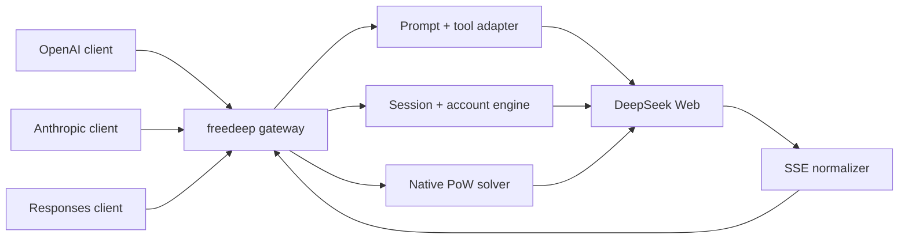

<div align="center">
  

  <h1>freedeep</h1>

  <p><strong>One Go binary. Three familiar APIs. Your DeepSeek Web session.</strong></p>
  <p>A fast, dependency-free compatibility gateway for local tools and AI clients.</p>

  <p>
    <a href="https://github.com/ertiti11/freedeep/actions/workflows/ci.yml"></a>
    <a href="https://github.com/ertiti11/freedeep/actions/workflows/secrets.yml"></a>
    <a href="https://github.com/ertiti11/freedeep/releases"></a>
    
    <a href="LICENSE"></a>
  </p>
</div>


> [!IMPORTANT]
> `freedeep` is an experimental, unofficial bridge to DeepSeek Web Chat. DeepSeek can change its private Web API at any time. For supported production workloads, use the official DeepSeek API.

## The idea

Most AI clients already speak OpenAI, Anthropic, or Responses-style APIs. DeepSeek Web does not. `freedeep` sits between them and translates the conversation, streaming, reasoning, tools, sessions, and errors without asking every client to learn a new protocol.

```text
your client  ->  familiar API  ->  freedeep  ->  DeepSeek Web
```

It is built as infrastructure, not as a script bundle: one static Go executable, no npm install, no runtime packages, native proof-of-work, bounded concurrency, account cooldowns, recovery logic, and secure-by-default container examples.

## Why freedeep

| | Capability | What it means |
| --- | --- | --- |
| ⚡ | Native Go core | A single cross-platform executable with standard-library-only source |
| 🔌 | Three API dialects | OpenAI Chat Completions, Anthropic Messages, and OpenAI Responses |
| 🌊 | Real streaming | Live SSE output, including tool-aware stream handling |
| 🧠 | Reasoning modes | Separate reasoning content for thinking-capable aliases |
| 🧰 | Tool compatibility | Tool schemas are adapted and parsed back into each client format |
| 🛡️ | Resilient sessions | Context compaction, fresh-chain retries, idle timeouts, and explicit resets |
| 👥 | Account pool | Multiple logins with cooldown and retry-after handling |
| 🔒 | Hardened delivery | Loopback default, optional proxy key, secret mounts, scratch container |

## Quick start

You need Go 1.24+ and Chrome, Chromium, or Edge for the first login.

```bash
git clone https://github.com/ertiti11/freedeep.git
cd freedeep
go build -o freedeep ./cmd/freedeep
./freedeep login
./freedeep serve
```

On Windows PowerShell:

```powershell
git clone https://github.com/ertiti11/freedeep.git
cd freedeep
go build -o freedeep.exe ./cmd/freedeep
.\freedeep.exe login
.\freedeep.exe serve
```

The server starts on `http://127.0.0.1:9655`. Confirm it is alive:

```bash
curl http://127.0.0.1:9655/health
```

Then send a request using any OpenAI-compatible client, or try the built-in one-shot command:

```bash
./freedeep ask "Explain why Go is a good fit for a local API gateway."
```

> [!CAUTION]
> `deepseek-auth.json` contains a live browser session. Never commit it, attach it to an issue, bake it into an image, or share it. The repository ignores common auth, cookie, credential, key, environment, and browser-profile filenames, and CI scans the complete Git history with Gitleaks.

## A request in 15 seconds

```bash
curl http://127.0.0.1:9655/v1/chat/completions \
  -H "Content-Type: application/json" \
  -d '{
    "model": "deepseek-chat",
    "user": "readme-demo",
    "messages": [
      {"role": "user", "content": "Give me one surprising fact about octopuses."}
    ]
  }'
```

For live Server-Sent Events, add `"stream": true`.

## How it works



For each request, `freedeep` selects an account, resolves the requested model alias, prepares a bounded transcript, obtains and solves the upstream proof-of-work challenge, and streams the normalized answer back in the protocol the caller expects.

## Compatible API surface

| Protocol | Endpoint | Streaming | Tools | Reasoning |
| --- | --- | :---: | :---: | :---: |
| OpenAI Chat Completions | `POST /v1/chat/completions` | ✅ | ✅ | `reasoning_content` |
| Anthropic Messages | `POST /v1/messages` | ✅ | ✅ | separate reasoning field |
| OpenAI Responses | `POST /v1/responses` | ✅ | ✅ | normalized output |

Operational endpoints:

| Method | Path | Purpose |
| --- | --- | --- |
| `GET` | `/health` | Process liveness |
| `GET` | `/readyz` | Readiness; returns `503` when no account is usable |
| `GET` | `/v1/models` | Supported public aliases |
| `GET` | `/v1/model-capabilities` | Real mode and feature mapping |
| `GET` | `/v1/sessions` | Active local sessions |
| `POST` | `/reset-session?agent=<id>` | Reset one agent chain |
| `POST` | `/reset-session?agent=all` | Reset every local chain |

The full request and response reference lives in [docs/api-documentation.md](docs/api-documentation.md).

## Model aliases

The running server is the source of truth: query `/v1/model-capabilities` before assuming a Web mode is available.

| Alias | Mode |
| --- | --- |
| `deepseek-chat` | Fast/default |
| `deepseek-reasoner` | Thinking |
| `deepseek-chat-search` | Fast + Web search |
| `deepseek-reasoner-search` | Thinking + Web search |
| `deepseek-expert` | Expert Web mode |

DeepSeek controls the upstream models, so availability can change independently of this repository.

## CLI

```text
freedeep [serve]             start the gateway
freedeep login               open a browser and capture a local session
freedeep import --input FILE import an auth or cookie export
freedeep auth                inspect or replace the current login
freedeep doctor              validate auth and upstream connectivity
freedeep doctor --offline    validate local files without network calls
freedeep ask "PROMPT"        ask a one-shot question
freedeep probe               probe current upstream model modes
freedeep healthcheck         check a locally running gateway
freedeep version             print the embedded build version
```

The optional extension in [`chrome-extension/`](chrome-extension/) exports credentials in a format accepted by `freedeep import`; it is an auth companion, not another server implementation.

## Configuration

Copy `.env.example` to `.env`, then change only what you need. Real environment variables win over values in the file.

| Variable | Default | Purpose |
| --- | --- | --- |
| `HOST` | `127.0.0.1` | Bind address |
| `PORT` | `9655` | HTTP port |
| `PROXY_API_KEY` | empty | Protect every non-health endpoint |
| `PROXY_API_KEY_FILE` | empty | Read that key from a mounted secret |
| `REQUIRE_PROXY_API_KEY` | `0` | Refuse startup when no proxy key exists |
| `PROXY_CORS_ORIGINS` | loopback only | Additional exact browser origins |
| `DEEPSEEK_AUTH_PATH` | `./deepseek-auth.json` | One or more comma-separated auth files |
| `DEEPSEEK_AUTH_DIR` | empty | Directory containing one account per JSON file |
| `DEEPSEEK_MAX_CONCURRENT` | `24` | Concurrent completion ceiling |
| `DEEPSEEK_REQUEST_DEADLINE_MS` | `120000` | Whole request/recovery budget |
| `DEEPSEEK_MAX_PROMPT_CHARS` | `80000` | Context budget before compaction |
| `DEEPSEEK_SHOW_REASONING` | `1` | Include upstream reasoning output |
| `LOG_LEVEL` | `info` | `debug`, `info`, `warn`, or `error` |
| `LOG_FORMAT` | `text` | `text` or `json` |

Every supported option, including browser paths, timeouts, retries, media behavior, and account cooldowns, is documented in [`.env.example`](.env.example).

## Network access

Loopback is the default. If another machine must reach the gateway, require a separate proxy key:

```bash
HOST=0.0.0.0 \
PROXY_API_KEY='use-a-long-random-value' \
REQUIRE_PROXY_API_KEY=1 \
./freedeep serve
```

Clients can authenticate with either `Authorization: Bearer <key>` or `x-api-key: <key>`. This proxy key is never sent to DeepSeek.

## Multiple accounts

Store one private JSON file per login outside the repository:

```text
/srv/freedeep-accounts/
  primary.json
  backup.json
```

Then start with:

```bash
DEEPSEEK_AUTH_DIR=/srv/freedeep-accounts NON_INTERACTIVE=1 ./freedeep serve
```

An account rejected with `401`, `403`, or `429` is placed on cooldown. If every account is cooling down, the gateway returns `429` with a useful `Retry-After` value instead of spinning.

## Hardened container

The runtime image is `FROM scratch`: it contains only the static binary and CA certificates. Authentication happens on the host, and secrets are mounted at runtime.

```bash
podman build --tag localhost/freedeep:local --file Containerfile .

podman secret create --replace freedeep-auth ./deepseek-auth.json
printf '%s' 'use-a-long-random-value' | \
  podman secret create --replace freedeep-proxy-key -

podman run --detach \
  --name freedeep \
  --read-only \
  --cap-drop=ALL \
  --security-opt=no-new-privileges \
  --user 1000:1000 \
  --publish 127.0.0.1:9655:9655 \
  --secret freedeep-auth,target=deepseek-auth.json,uid=1000,gid=1000,mode=0400 \
  --secret freedeep-proxy-key,target=proxy-api-key,uid=1000,gid=1000,mode=0400 \
  localhost/freedeep:local
```

The container refuses to start without the mounted proxy key.

## Build quality

```bash
go test ./...
go vet ./...
go test -race ./...
go build -trimpath -o freedeep ./cmd/freedeep
```

CI repeats these checks across Linux, macOS, and Windows. Integration tests run the complete gateway against a fake upstream, including proof-of-work verification, streaming, retries, tool calls, session recovery, rate limits, and all three compatibility formats.

Install the repository's local Git guards once after cloning:

```powershell
.\scripts\install-hooks.ps1
```

```bash
./scripts/install-hooks.sh
```

The versioned `pre-commit` hook scans the exact staged tree with Gitleaks, checks formatting, rejects tracked secret-like paths, runs `go vet`, and runs the test suite. The `pre-push` hook scans all reachable history and repeats vetting and tests. CI independently repeats the checks so bypassing a local hook does not bypass repository validation.

Optional live smoke tests require an already running, logged-in gateway:

```bash
FREEDEEP_LIVE_URL=http://127.0.0.1:9655 \
FREEDEEP_LIVE_MODEL=deepseek-chat \
go test ./internal/livetest -v
```

## Releases

Every semantic version tag produces a GitHub Release automatically. The release workflow cross-compiles five binaries and publishes SHA-256 checksums:

- Linux: `amd64`, `arm64`
- macOS: `amd64`, `arm64`
- Windows: `amd64`

To publish a version:

```bash
git tag -a v1.0.0 -m "freedeep v1.0.0"
git push origin v1.0.0
```

GitHub Actions builds the artifacts from that exact tag and generates the release notes.

## Repository map

```text
cmd/freedeep/       CLI and process entry point
internal/authcli/   browser login, import, and diagnostics
internal/cdp/       minimal Chrome DevTools Protocol client
internal/deepseek/  upstream client, model map, and SSE parser
internal/pow/       native DeepSeekHashV1 solver
internal/prompt/    transcript conversion and context compaction
internal/server/    HTTP APIs, streaming writers, and recovery engine
internal/state/     account pool and isolated session state
internal/toolcall/  tool schema adapter and parser
chrome-extension/   optional credential export companion
```

## Security model

- Credentials and browser profiles are local-only and excluded by multiple ignore patterns.
- The container build context is allowlisted; credentials cannot enter it accidentally.
- GitHub Actions scans complete history for secrets on every push and pull request.
- The HTTP server binds to loopback unless explicitly configured otherwise.
- A fail-closed proxy-key mode is available and enabled in the container image.
- Request size, concurrency, wall-clock, fetch, and stream-idle limits are enforced.

If a real credential ever reaches Git, revoke it first. Removing it from a later commit does not invalidate the exposed value.

Report vulnerabilities privately through GitHub Security Advisories; see [SECURITY.md](SECURITY.md). Please read [CONTRIBUTING.md](CONTRIBUTING.md) before opening a pull request.

## Project status

`freedeep` is designed for local experimentation, development tools, and personal integrations. It is not affiliated with or endorsed by DeepSeek. The Web contract is private and can break without notice; authentication may expire and model mappings may move.

Please use it responsibly and follow the terms that apply to your DeepSeek account.

## Credits and license

The native Go rewrite is maintained by [ertiti11](https://github.com/ertiti11). It builds on prior work credited in [LICENSE](LICENSE), including the original ForgetMeAI project and its English adaptation. The implementation, documentation, and visual identity in this repository are maintained as `freedeep`.

Released under the MIT License.
